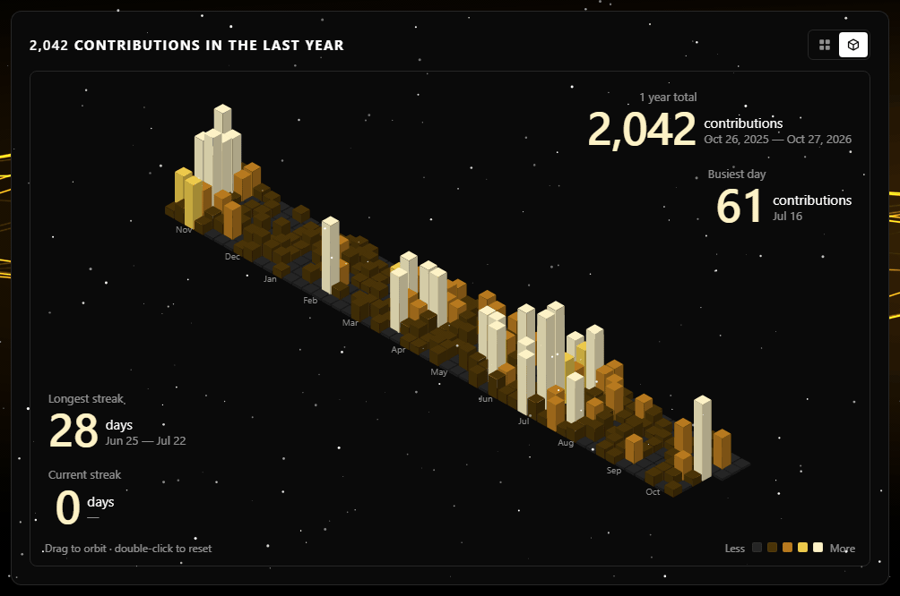

<div align="center">

[](https://git.io/typing-svg)


<h2 align="center">Connect me on my socials</h2>

[](https://www.linkedin.com/in/buildwithsimran/)
[](mailto:contact.simran.rajpal@gmail.com)
[](https://github.com/buildwithsimran)

<h2 align="center">Things I made</h2>

[](https://buildwithsimran.vercel.app)
[](https://gta-6-requirements.vercel.app)
[](https://lootlens.antideploy.com)

</div>


<div align="center">

<a href="https://buildwithsimran.vercel.app/skyline">

</a>

<a href="https://buildwithsimran.vercel.app/skyline"><strong>view it live →</strong></a>

</div>

---

## About

Hi, I'm **Simran** — a Full Stack Developer who loves bringing ideas to life on the web.

I work with **React, JavaScript, Supabase, and modern web tools** daily. I'm big on UI/UX, clean animations, and building things that feel good to use.

On the backend, I work with **Node.js and Supabase**, while using **PostgreSQL** for structured application data.

Learning something new every day — that's the goal.

### Open To

* Full Stack Development
* Frontend Development
* Web Development projects
* UI-focused web applications
* Open-source contributions
* Developer collaborations

---

## Engineering Focus

| Domain                 |      Focus     | Details                                            |
| :--------------------- | :------------: | :------------------------------------------------- |
| Full Stack Development |    `Primary`   | Building complete modern web applications          |
| Frontend Engineering   | `Strong Focus` | React and JavaScript based web experiences         |
| Backend Development    |    `Active`    | Node.js and Supabase powered application workflows |
| Database Development   |    `Active`    | PostgreSQL backed application data                 |
| Responsive UI          | `Strong Focus` | Interfaces designed across screen sizes            |
| UI / UX                |    `Growing`   | Improving usability and visual interaction         |
| Web Animations         |  `Interested`  | Creating interactive and dynamic web experiences   |
| Data Technologies      |   `Exploring`  | Pandas, Matplotlib, Scikit-learn, and Power BI     |

---

## Development Focus

### Full Stack Web Development

`React` · `JavaScript` · `Node.js` · `Supabase` · `PostgreSQL`

Focused on building real-world full-stack projects and making UIs that people actually enjoy using.

**Current Engineering Scope**

* Building full-stack web applications
* Developing React-based user interfaces
* Working with JavaScript and modern web technologies
* Building backend workflows with Node.js and Supabase
* Managing application data with PostgreSQL
* Creating responsive web interfaces
* Exploring animations and interactive experiences
* Improving UI/UX and frontend architecture
* Learning advanced web development concepts

`React` `JavaScript` `Node.js` `Supabase` `PostgreSQL` `Responsive UI` `Animations`

---

## Development Highlights

<div align="center">

| Focus                      | Details                                                                   |
| :------------------------- | :------------------------------------------------------------------------ |
| **Full Stack Development** | Building modern applications across frontend and backend technologies     |
| **Modern Web Experiences** | Focused on interactive and responsive browser experiences                 |
| **Frontend Engineering**   | Working with React, JavaScript, HTML, and CSS                             |
| **Backend Development**    | Building with Node.js and Supabase                                        |
| **Database Development**   | Working with PostgreSQL                                                   |
| **UI / UX**                | Interested in usability, animations, and modern web design                |
| **Continuous Learning**    | Actively improving development skills and exploring advanced web concepts |

</div>

---

## Technology Ecosystem

### Frontend


### Backend & Data


### Data & Analytics


### Development & Deployment


---

## GitHub Analytics

<div align="center">


<br>


</div>

---

## GitHub Trophies

<div align="center">

[](https://github.com/ryo-ma/github-profile-trophy)

</div>

---

## Current Focus

```yaml
Learning:
  - Advanced Web Development Concepts
  - Frontend Architecture
  - Modern Web Technologies
  - Improved UI UX Engineering

Building:
  - Full Stack Web Applications
  - Modern Web Experiences
  - Responsive User Interfaces
  - Interactive Websites

Exploring:
  - UI UX
  - Web Animations
  - Advanced Frontend Development
  - Data Technologies

Open To:
  - Full Stack Development
  - Frontend Development
  - Web Projects
  - Open Source Contributions
  - Developer Collaborations
```

---

<div align="center">

### *"Keep building, stay curious."*

</div>

 
